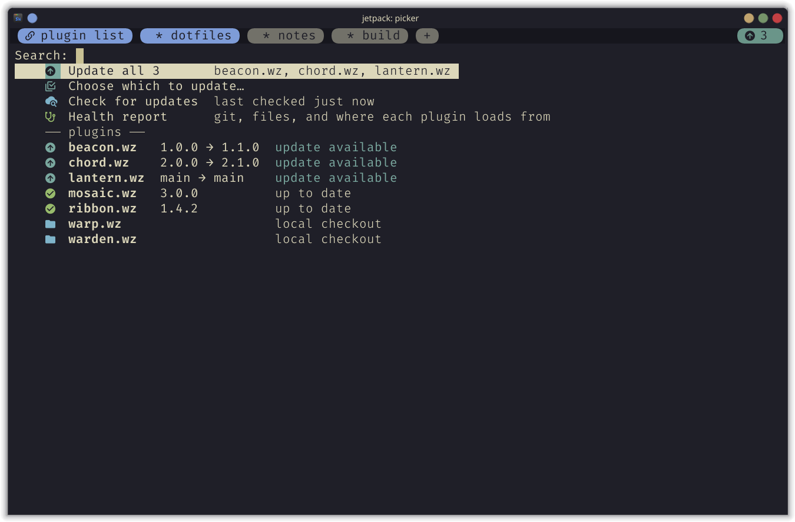
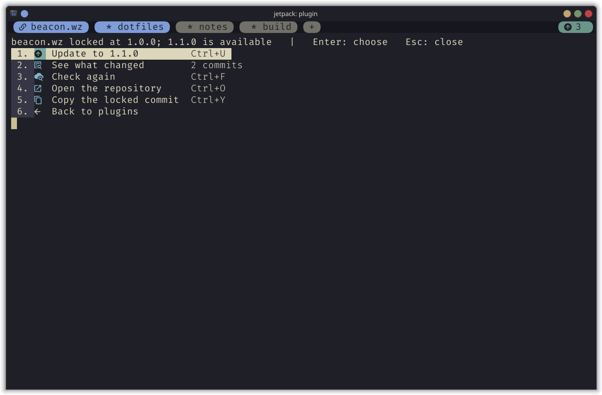
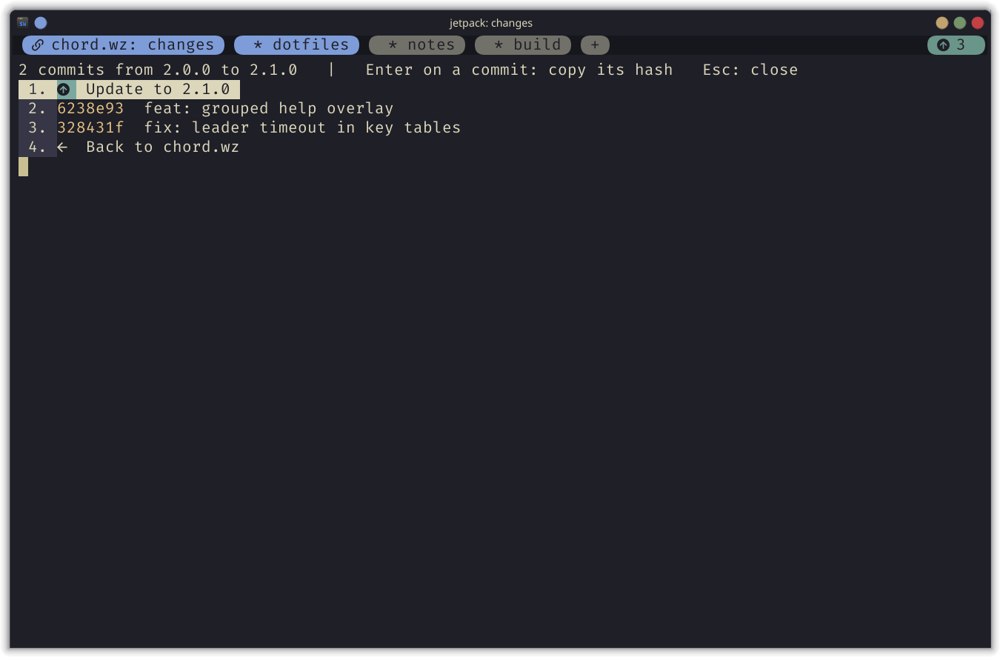
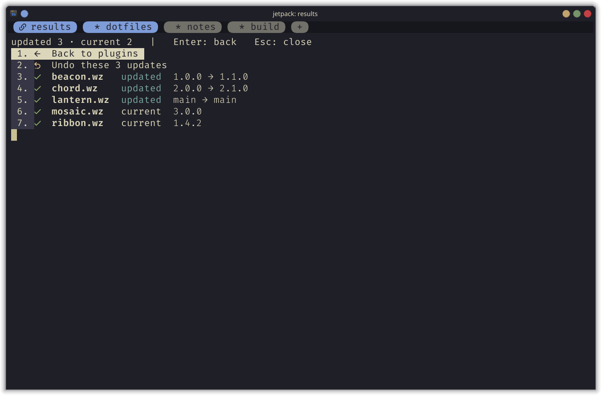

# jetpack.wz [](https://github.com/sravioli/jetpack.wz/releases/latest)

<!-- [](https://github.com/michaelbrusegard/awesome-wezterm) -->

[](https://github.com/sravioli/jetpack.wz/actions/workflows/tests.yaml)
[](https://github.com/sravioli/jetpack.wz/actions/workflows/lint.yaml)
[](https://coveralls.io/github/sravioli/jetpack.wz)
[](../LICENSE)
[](../LICENSE-DOCS)

Pin [WezTerm](https://wezterm.org/) plugins to versions, with a lockfile and a picker.

`wezterm.plugin.require` always clones the default branch of a plugin.
`wezterm.plugin.update_all()` moves every plugin to its newest commit.
jetpack pins each plugin to a tag, a semver range, a branch, or a commit. It
records the exact commit in `jetpack-lock.json` next to your `wezterm.lua`.
Commit that file, and every machine runs the same plugin code.

A config reload runs no git. jetpack puts the locked checkouts on
`package.path` and loads them from disk. git runs only when a clone is
missing, and when you start an operation from the picker or the API.

[Showcase](#showcase) · [Quick start](#quick-start) · [Usage](#usage) · [Configuration](#configuration) · [API reference](#api-reference) · [Troubleshooting](#troubleshooting) · [Development](#development) · [License](#license)

## Showcase

The screenshots show [kanagawa-wave](https://github.com/kanagawa-community/wezterm) (dark) and [kanagawa-lotus](https://github.com/kanagawa-community/wezterm) (light), in Fira Code Nerd Font. The bar is [mosaic.wz](https://github.com/sravioli/mosaic.wz) with the jetpack modules.

### `jetpack.action.open()`

All plugins in one list. The first line shows what needs attention. The rows below it are actions, and they appear only when they apply.

<picture>
  <source media="(prefers-color-scheme: light)" srcset="assets/picker/light.png">
  
</picture>

### Plugin menu

Press Enter on a plugin. The menu shows where the plugin stands and only the actions that fit.

<picture>
  <source media="(prefers-color-scheme: light)" srcset="assets/plugin/light.png">
  
</picture>

### See what changed

The commits that an update brings in. Press Enter on a commit to open it on GitHub.

<picture>
  <source media="(prefers-color-scheme: light)" srcset="assets/changes/light.png">
  
</picture>

### Results

One row for each plugin: what happened, the version it reached, or why it failed.

<picture>
  <source media="(prefers-color-scheme: light)" srcset="assets/results/light.png">
  
</picture>

### Status bar

The modules `jetpack.status` and `jetpack.updates` for mosaic.wz show the open view and the number of updates.

<picture>
  <source media="(prefers-color-scheme: light)" srcset="assets/bar/light.png">
  
</picture>

## Quick start

### Requirements

Requires **WezTerm nightly** and Git. Set `git` to the executable path if Git is not on `PATH`.

jetpack installs [warp.wz](https://github.com/sravioli/warp.wz) and
[warden.wz](https://github.com/sravioli/warden.wz) and pins them itself.
Add `sravioli/warp.wz` or `sravioli/warden.wz` to `spec` to choose their version.
[mosaic.wz](https://github.com/sravioli/mosaic.wz) is optional.

### Install and run

Put this at the top of `wezterm.lua`. It clones jetpack one time, at a fixed
tag, so jetpack is pinned too. Replace `<tag>` with a release tag.

```lua
local wezterm = require "wezterm"

local data = os.getenv "XDG_DATA_HOME" or (wezterm.home_dir .. "/.local/share")
-- Windows: local data = os.getenv "LOCALAPPDATA"
local dir = data .. "/wezterm/jetpack/sravioli__jetpack.wz"
local f = io.open(dir .. "/plugin/init.lua")
if f then
  f:close()
else
  wezterm.run_child_process {
    "git", "clone", "--branch", "<tag>", "https://github.com/sravioli/jetpack.wz", dir,
  }
end
package.path = dir .. "/plugin/?.lua;" .. dir .. "/plugin/?/init.lua;" .. package.path

local jetpack = require "jetpack.api"
jetpack.setup {
  spec = {
    { "sravioli/jetpack.wz", version = "^0.1" }, -- lets jetpack update itself
    { "sravioli/beacon.wz", version = "*" },
    { "sravioli/chord.wz", tag = "1.3.0" },
    { "kanagawa-community/wezterm", branch = "main" },
  },
}

local config = wezterm.config_builder()

-- Load plugins as before. Managed URLs come from the pinned checkouts.
local chord = wezterm.plugin.require "https://github.com/sravioli/chord.wz"
-- or: local chord = jetpack.require "chord.wz"

jetpack.apply_to_config(config)
config.keys = {
  { key = "P", mods = "CTRL|SHIFT", action = jetpack.action.open() },
}
return config
```

On the first start, jetpack clones each plugin. It checks out the newest
commit that matches the spec and writes `jetpack-lock.json`. Press
**Ctrl+Shift+P** to open the picker.

## Usage

### Pin a plugin

Each entry in `spec` is a string or a table. Use one of these fields to choose
the version.

| Field          | Meaning                                                                                                                                                                               |
| -------------- | ------------------------------------------------------------------------------------------------------------------------------------------------------------------------------------- |
| `[1]` or `url` | `owner/repo` for GitHub, or a git URL (`https://…`, `file://…`).                                                                                                                      |
| `version`      | A semver range over tags: `*`, `^1`, `^0.2.1`, `~1.4`, `1.4` (any 1.4.x), `>=1.2`, or an exact `1.4.2`. A leading `v` on tags is allowed. A prerelease matches only an exact version. |
| `tag`          | One tag.                                                                                                                                                                              |
| `commit`       | One commit.                                                                                                                                                                           |
| `branch`       | Follow a branch. If no version field is set, jetpack follows the default branch.                                                                                                      |
| `dir`          | A local checkout. jetpack loads it as it is and never runs git on it. Use it for plugin development.                                                                                  |
| `name`         | The display name. The default is the repository name.                                                                                                                                 |

If a spec sets more than one version field, `commit` wins, then `tag`, then
`version`, then `branch`.

jetpack checks the options and the spec entries with warden.wz on every config
load. A wrong type or value is an error. An unknown field (for example,
a misspelt `verison`) is a warning in the WezTerm log. Set `validate = false`
to skip this check and to never load warden.wz.

### Update and undo

Each operation is a plain function that returns a report with one result for
each plugin. The picker runs the same functions.

| Function                                | What it does                                                                                                                                                               |
| --------------------------------------- | -------------------------------------------------------------------------------------------------------------------------------------------------------------------------- |
| `jetpack.sync(ids?)`                    | Clones missing plugins, checks out the locked commits, and locks plugins that the lockfile does not list. Run it after you pull a lockfile from another machine.           |
| `jetpack.check(ids?)`                   | Fetches and records the newest commit that each spec accepts. It changes nothing else.                                                                                     |
| `jetpack.update(ids?)`                  | Fetches, checks out the newest commit that each spec accepts, and writes it to the lockfile. It keeps the previous commit for `undo`.                                      |
| `jetpack.undo(ids?)`                    | Goes back to the version that each plugin had before its last update, and locks it.                                                                                        |
| `jetpack.restore(ids?)`                 | Checks out the locked commits again, for example after you revert the lockfile with git.                                                                                   |
| `jetpack.orphans()` / `jetpack.clean()` | Lists, or deletes, the clones that no spec names. jetpack never deletes a clone that has changed or untracked files, or commits on no remote.                              |
| `jetpack.status()`                      | Shows, for each plugin, the locked version, the checked-out commit, the newest version that `check` found, and a state.                                                    |
| `jetpack.doctor()`                      | Reports the health of git, the root, the lockfile, the hooks, the real load path of each plugin, and the unpinned plugins. It logs the report line by line and returns it. |

`ids` are ids (`owner/repo`) or names (`beacon.wz`). jetpack never checks out
over uncommitted changes in a clone. It reports the plugin as failed instead.

`check` and `update` fetch all plugins in parallel (one after the other on
Windows). Clones keep the full history, so tags, the changelog view, and undo
work offline.

To run an operation from a key binding, use `jetpack.action.update()`,
`jetpack.action.sync()`, or `jetpack.action.check()`.

### Use the picker

`jetpack.action.open()` opens the plugin list. Its first line says what needs
attention, for example `5 plugins · 2 updates available · checked 2m ago`.

The rows below it are actions. jetpack shows a row only when it applies.

| Row                            | Shown when                                        | Action                                                                                      |
| ------------------------------ | ------------------------------------------------- | ------------------------------------------------------------------------------------------- |
| Update _name_ / Update all _N_ | `check` found updates                             | Updates the plugins. One failure does not stop the others.                                  |
| Choose which to update…        | Two or more updates exist                         | Opens a checklist. Enter ticks or unticks a plugin. The top row updates the ticked plugins. |
| Fix _N_ plugins                | Plugins are missing, moved by hand, or not locked | Installs, restores, or locks them, as the hint says.                                        |
| _N_ plugins are not pinned     | Plugins load without a spec entry                 | Lists them with the spec line that pins each one. Enter copies it.                          |
| Check for updates              | Always                                            | Fetches every plugin and shows when the check last ran.                                     |
| Remove _N_ unused clones       | Clones exist that no spec names                   | Asks first, then deletes them.                                                              |
| Health report                  | Always                                            | Shows `jetpack.doctor()`. Enter copies it.                                                  |

The icons and state words use the ANSI colors of your color scheme. Each
color has one meaning: aqua for an update, lime for a good state, yellow for a
fix that is needed, blue for information, fuchsia for a plugin that is not
managed or has local changes, and red for a failure or a removal.

The plugins follow the actions. Plugins that need attention come first, with
their version and state in plain words.

Press Enter on a plugin to open its menu. The menu has one sentence about the
plugin and only the actions that fit. Examples are _Update to 1.2.0_,
_See what changed_, _Undo the last update_, _Go back to the locked version_,
_Open the repository_, and _Copy the locked commit_.

Shortcuts work in the list and in a plugin menu. They act on the highlighted
plugin, or on the plugin of the menu. Each menu entry shows its shortcut.

| Key      | Action                                     |
| -------- | ------------------------------------------ |
| `Ctrl+U` | Update.                                    |
| `Ctrl+R` | Restore.                                   |
| `Ctrl+F` | Check. On an action row, check everything. |
| `Ctrl+O` | Open the repository.                       |
| `Ctrl+Y` | Copy the locked commit.                    |

While an operation runs, the status bar shows the progress (for example,
`jetpack: checking beacon.wz 3/5`). With mosaic.wz, the progress goes to the
`jetpack.progress` module if a layout uses it. If not, it goes to the `notice`
slot. Without mosaic.wz, it goes to the right status. Set `picker.log_pane = true`
to also follow each step in a split pane.

When the operation ends, a results view opens. It has one row for each plugin.
After an update, it offers _Undo these updates_. Enter goes back to the plugin
list. Escape closes the view. Both keys close the log pane. If the operation
changed checked-out code, the config reloads first. The results open when the
reload ends. jetpack also writes everything to the WezTerm log.

### Check for updates automatically

jetpack checks for updates in the background. The default is one check each
day, 10 seconds after the first window event once a check is due. The progress
shows in the bar like for any operation. The result goes to `jetpack.updates`
and to the WezTerm log. No view opens.

jetpack keeps the next due time in `<root>/.next-check`. A restart or another
WezTerm process keeps to the same interval. Set `auto_check = false` to turn
the check off.

## Configuration

### Example

Only `spec` is required. These values are the defaults:

```lua
jetpack.setup {
  spec = {},
  root = "<data dir>/wezterm/jetpack",
  lockfile = wezterm.config_dir .. "/jetpack-lock.json",
  git = "git",
  strict = false,
  validate = true,
  auto_check = { enabled = true, interval_hours = 24, delay_seconds = 10 },
  picker = {
    title = "Jetpack",
    hint_position = "top",
    progress = "auto",
    keys = {
      update = { key = "u", mods = "CTRL" },
    },
  },
}
```

### Options

| Option                      | Type                                           | Default                          | Description                                                                                   |
| --------------------------- | ---------------------------------------------- | -------------------------------- | --------------------------------------------------------------------------------------------- |
| `spec`                      | `(string\|table)[]`                            | `{}`                             | The plugins to manage. See [Pin a plugin](#pin-a-plugin).                                     |
| `root`                      | `string`                                       | `<data dir>/wezterm/jetpack`     | The directory that holds the clones.                                                          |
| `lockfile`                  | `string`                                       | `<config dir>/jetpack-lock.json` | The lockfile. Commit it to git.                                                               |
| `git`                       | `string`                                       | `"git"`                          | The git executable (name or path).                                                            |
| `strict`                    | `boolean`                                      | `false`                          | Raise an error, instead of loading the unpinned copy of WezTerm, when a clone is missing.     |
| `validate`                  | `boolean`                                      | `true`                           | Check the options and the specs with warden.wz.                                               |
| `auto_check`                | `table\|false`                                 | see below                        | The background check. `false` turns it off.                                                   |
| `auto_check.enabled`        | `boolean`                                      | `true`                           | Turn the background check on or off.                                                          |
| `auto_check.interval_hours` | `number`                                       | `24`                             | Hours between checks. The minimum is 1.                                                       |
| `auto_check.delay_seconds`  | `number`                                       | `10`                             | Seconds to wait after the first window event.                                                 |
| `picker.title`              | `string`                                       | `"Jetpack"`                      | The title of the picker.                                                                      |
| `picker.fuzzy`              | `boolean`                                      | `true`                           | Fuzzy search in the plugin list.                                                              |
| `picker.icons`              | `boolean`                                      | `true`                           | Show icons.                                                                                   |
| `picker.hints`              | `boolean`                                      | `true`                           | Show the shortcut hints.                                                                      |
| `picker.hint_position`      | `"top"\|"status"\|"none"`                      | `"top"`                          | Where the hints show. `"status"` needs `jetpack.set_picker_adapter`.                          |
| `picker.confirm`            | `boolean`                                      | `true`                           | Ask before `clean` deletes clones.                                                            |
| `picker.progress`           | `"auto"\|"mosaic"\|"notice"\|"status"\|"none"` | `"auto"`                         | Where the progress shows. `"auto"` uses `jetpack.progress` if a layout names it.              |
| `picker.log_pane`           | `boolean`                                      | `false`                          | Also follow the progress in a split pane.                                                     |
| `picker.key_table`          | `string`                                       | `"jetpack_picker"`               | The name of the key table.                                                                    |
| `picker.keys.<action>`      | `{ key, mods }\|false`                         | see the shortcut table           | The key of `update`, `restore`, `check`, `browse`, or `copy`. Set it to `false` to remove it. |

To show the hints somewhere else, use
`jetpack.set_picker_adapter { keys, open }`. For example, show them in the
status bar of [chord.wz](https://github.com/sravioli/chord.wz). Call it
before `apply_to_config`.

### Behavior and precedence

`setup` puts the `plugin/` directory of each checkout first on `package.path`.
It does this before anything loads warp or warden. A plugin that loads its
dependencies with `require "warp.api"` gets the pinned copy.

`setup` wraps `wezterm.plugin.require`. Managed URLs load from the pinned
checkout. jetpack sends other URLs to the loader of WezTerm and records them as
not pinned. Such plugins are, for example, a dependency of one of your plugins.
jetpack logs each one and lists it in the picker with the spec line that pins it.

`setup` also wraps `wezterm.plugin.list`. It puts each installed managed plugin
first, in place of the entry of WezTerm for the same URL. Plugins that look
themselves up there find the pinned checkout. Until the clone of a plugin
exists, the entry of WezTerm stays, so a first-run fallback finds itself.

A clone exists only when jetpack checked it out at a resolved commit. If an
install fails (for example, no tag matches the range), jetpack deletes the new
clone and logs the error. It tries again on the next reload. Until then,
`wezterm.plugin.require` of that URL falls back to the unpinned loader of
WezTerm, so the config keeps working. Set `strict = true` to raise an error
instead.

The lockfile keeps, for each plugin, the commit, the ref it came from, and the
commit before the last update (`prev`, `prev_ref`) for undo. The file has a `version` field (now 1). jetpack reads
lockfiles from before it existed, and rewrites them on the next write. A
lockfile with a newer version is an error: update jetpack. `check` results
stay in `wezterm.GLOBAL`. The picker and the bar know about available updates
after a reload.

Operations that run git hold a lock (`<root>/.jetpack.lock`). Two WezTerm processes
never change the same clones at the same time. The second process reports
"another WezTerm is already working on plugins" and does nothing. jetpack takes
over a lock that is older than 15 minutes, because a crash left it.

jetpack does not support parallel first installs (clones run one after the
other), conditional specs, build hooks, lazy loading, or specs that come from
modules.

## API reference

The [API reference](../docs/api.md) lists every function and value with its
parameters and return values. It is generated from the LuaLS annotations in
`plugin/`, so it matches the code. It has these sections:

- [jetpack](../docs/api.md#jetpack)
- [Types](../docs/api.md#types)

`?` marks optional arguments. The operations in [Update and undo](#update-and-undo)
return one result for each plugin. Underscore-prefixed helpers are internal.

## mosaic integration

jetpack has three modules for the [mosaic.wz](https://github.com/sravioli/mosaic.wz)
status bar. mosaic reads them only when a layout names them, so they cost
nothing otherwise.

```lua
mosaic.setup {
  layout = {
    left = { "jetpack.status" },
    right = { "jetpack.progress", "jetpack.updates", "clock" },
  },
  options = {
    ["jetpack.updates"] = { names = true },
  },
}
```

| Module             | Shows                                                                                                                                                                                                                                               | Options                                                                                                                |
| ------------------ | --------------------------------------------------------------------------------------------------------------------------------------------------------------------------------------------------------------------------------------------------- | ---------------------------------------------------------------------------------------------------------------------- |
| `jetpack.updates`  | The number of plugins for which the last check found a newer version. Hidden when there are none.                                                                                                                                                   | `icon` (string, or `false` to hide it; default `md_arrow_up_circle`), `names` (show the plugin names, not the number). |
| `jetpack.status`   | The jetpack view that is open in this window: `plugin list`, the name of a plugin, `choose updates`, `checking for updates…`, `results`, `confirm`. Hidden when no view is open, unless plugins need attention (`1 missing`, `2 unlocked`, tinted). | `icon` (default `md_link_variant`), `warn_color` (default `4`).                                                        |
| `jetpack.progress` | The operation that runs, for example `checking beacon.wz 3/5`. Hidden otherwise.                                                                                                                                                                    | `icon` (default `md_sync`), `prefix` (keep the `jetpack:` prefix).                                                     |

No module runs git. `jetpack.updates` and `jetpack.status` read the lockfile
one time for each config load. `jetpack.updates` also reads the check results
in `wezterm.GLOBAL`. `jetpack.status` checks that each clone exists when no view
is open. All three modules redraw on the `jetpack.progress` event. The picker
emits it at every step.

While a layout uses `jetpack.progress`, `picker.progress = "auto"` sends the
progress there, not to the `notice` slot of mosaic.

## Troubleshooting

### A plugin loads, but jetpack does not pin it

A plugin that loads through `wezterm.plugin.require` without a spec entry is
not pinned. The picker lists it with the spec line that pins it. Add that line
to `spec`. If the clone of a pinned plugin is missing, WezTerm loads its own
unpinned copy. Run `jetpack.sync()` to install the clone.

### An operation does nothing

If the report says "another WezTerm is already working on plugins", another
process holds the lock. Wait for it to end. jetpack takes over a lock that is
older than 15 minutes. If a plugin shows as failed, check for uncommitted
changes in its clone. jetpack never checks out over them.

### The picker does not show an update

Run **Check for updates** in the picker, or `jetpack.check()`. `check` only
finds commits that the spec accepts. A `tag` or `commit` field pins one
version, so no update exists. A `version` range excludes newer majors, for
example `~1.4` excludes `1.5.0`.

Run `jetpack.doctor()` for a report of git, the lockfile, the hooks, and the
real load path of each plugin. File
[issues](https://github.com/sravioli/jetpack.wz/issues) with the report, the
plugin revision, the WezTerm build, and the lines of `spec` that are involved.

## Development

### Local checkout

Load the working tree directly. Edits take effect on the next config reload,
without a commit or a plugin update. Adjust the path to your clone:

```lua
local wezterm = require "wezterm"
local root = wezterm.home_dir .. "/path/to/jetpack.wz/plugin/"
package.path = root .. "?.lua;" .. root .. "?/init.lua;" .. package.path
local jetpack = require "jetpack.api"
```

Dependencies must stay available through the loader or `package.path`.

### Editor support

The modules have LuaLS annotations. Load them with `require "jetpack.api"`
as shown above, and the language server finds the types. See the
[API](../plugin/jetpack/api.lua) and the [schema](../plugin/jetpack/config.lua).

### Checks and contributions

From the repository root, with Lua 5.4 and the named tools installed:

```sh
busted --verbose
luacheck plugin spec
selene --display-style=quiet plugin
stylua --check plugin spec
```

The specs use a hand-written wezterm mock and the sibling `../warp.wz` and
`../warden.wz` checkouts. The operation specs run real git against local
repositories. CI runs the same checks on every push. See the
[contributing guide](contributing.md). Changes use Conventional Commits and
need focused specs.

### Screenshots

`scripts/screenshots.sh` makes the images in `.github/assets`. It installs demo
plugins from throwaway git repositories, so it does not use the network or your
own plugins. It needs KDE Plasma (`spectacle`), `wezterm`, `git`, ImageMagick,
and sibling checkouts of warp.wz, warden.wz, and mosaic.wz. Run it from a
session that you leave alone, because each shot opens a window that must keep
the focus.

```sh
scripts/screenshots.sh                 # every scene
scripts/screenshots.sh picker results  # only these scenes
```

## License

Code: [GNU GPL v2](../LICENSE). Documentation:
[CC BY-NC 4.0](../LICENSE-DOCS). Preserve existing attribution.
